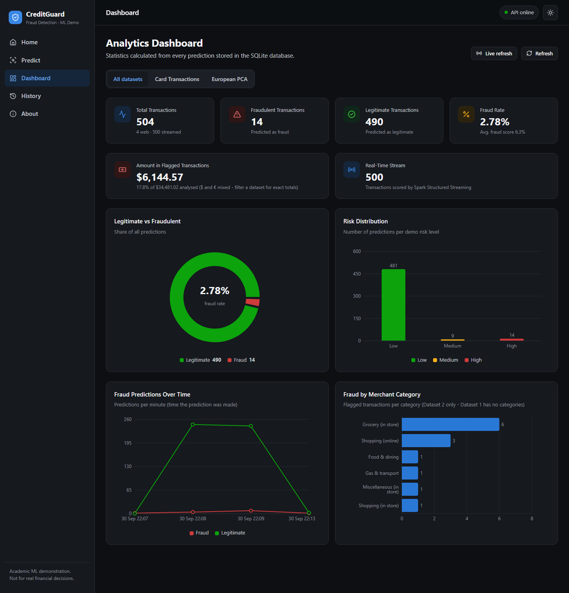
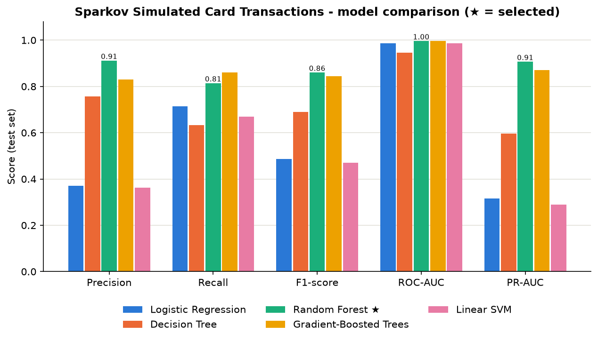

# CreditGuard — Big Data Credit Card Fraud Detection with Apache Spark

> **Course:** CSET-371 Big Data Analytics & Business Intelligence (B.Tech, 5th semester)
> **Academic project.** This application is an academic machine-learning demonstration and should not be used for
> real financial decision-making.

CreditGuard is an end-to-end **Big Data analytics pipeline** for credit card fraud detection. **Apache Spark
(PySpark)** ingests and cleans **2.1 million transactions from two datasets**, engineers behavioural features with Spark
window functions, and trains and compares **five Spark MLlib models**. The best model is served in three ways:

1. a **React + FastAPI website** that scores single transactions and shows a live analytics dashboard,
2. a **Spark Structured Streaming** job that scores transactions in real time and raises fraud alerts,
3. clean tables exported for a **Power BI** Business Intelligence dashboard.

---

## 1. Problem Statement & Objectives

Card fraud causes large financial losses and is rare (0.17–0.5% of transactions), so it is hard to detect and plain
accuracy is misleading. Banks process millions of transactions, so the solution must scale.

**Objectives**
1. Build a scalable PySpark pipeline: ingestion → cleaning → EDA → feature engineering → modelling.
2. Train and compare at least five Spark MLlib classifiers using imbalance-aware metrics.
3. Detect fraud in (near) real time with Spark Structured Streaming.
4. Provide decision support through a web dashboard and a Power BI report.
5. Align the solution with the UN Sustainable Development Goals.

## 2. Technology Stack

| Layer | Technologies |
|---|---|
| **Big Data processing** | Apache Spark 3.5 (PySpark), Spark SQL, Spark MLlib, Spark Structured Streaming, Parquet |
| Runtime | Java 17, Hadoop winutils (Windows), local mode `local[*]` (same code runs on a cluster / Databricks) |
| Machine Learning | Spark MLlib: Logistic Regression, Decision Tree, Random Forest, Gradient-Boosted Trees, Linear SVM |
| Business Intelligence | Power BI Desktop (from `powerbi/data/*.csv`) + React/Recharts dashboard |
| Backend | Python 3.12, FastAPI, Uvicorn, Pydantic, SQLAlchemy, SQLite |
| Frontend | React 19, Vite, Axios, Recharts, React Router |
| Reporting | Pandas, Matplotlib, scikit-learn (only to draw ROC/PR curves) |
| Testing | Pytest + FastAPI TestClient (real Spark models) |

## 3. Datasets

| | Dataset 1 — ULB European (real) | Dataset 2 — Sparkov (simulated) |
|---|---|---|
| Source | Kaggle `mlg-ulb/creditcardfraud` | Kaggle `kartik2112/fraud-detection` |
| Rows | 284,807 | **1,852,394** |
| Frauds | 492 (0.172%) | 9,651 (0.521%) |
| Period | 2 days, Sept 2013 | Jan 2019 – Dec 2020 |
| Features | `Time`, `V1`–`V28` (PCA-anonymised), `Amount` | category, amount, time, city/state, lat/long, age, gender, job… |
| Why | Real bank data, standard benchmark | Readable columns → behavioural features + Power BI insights; time-based split |

Download instructions: [data/README.md](data/README.md).

## 4. Architecture

```text
 Raw CSV (2 datasets, 2.1M rows)
        │
        ▼
 ┌───────────────────────── Apache Spark (PySpark) ─────────────────────────┐
 │ s01 Ingest & clean ──► Parquet                                           │
 │ s02 EDA & statistics (Spark SQL, t-test, chi-square) ──► figures         │
 │ s03 Feature engineering (window functions) ──► Parquet                   │
 │ s04 Train 5 MLlib models × 2 datasets ──► best PipelineModel             │
 │ s05 Evaluate: confusion matrices, ROC / PR curves, comparison charts     │
 │ s07 Export analytics tables ──────────────────────────────► Power BI     │
 └──────────────────────────────────────────────────────────────────────────┘
        │ saved models (models/spark/)
        ├──────────────────────────────┬─────────────────────────────────────┐
        ▼                              ▼                                     ▼
 FastAPI backend                Spark Structured Streaming (s06)       Power BI report
 (Spark model in memory)        producer ► JSON micro-batches ►        (KPIs, maps,
 POST /predict/{dataset}        score ► alerts ► Parquet + SQLite       model performance)
        │                              │
        └────────► SQLite ◄────────────┘
                     │
                     ▼
              React dashboard (Home · Predict · Result · Dashboard · History · About)
```

## 5. Folder Structure

```text
credit-card-fraud-detection/
├── spark_pipeline/            # ★ Big Data pipeline (PySpark) - run in order
│   ├── spark_session.py       # SparkSession + Windows fixes (Java 17, winutils, paths with spaces)
│   ├── config.py              # paths & settings
│   ├── plot_style.py          # shared chart style
│   ├── s01_ingest_clean.py    # ingestion, data quality, cleaning → Parquet
│   ├── s02_eda.py             # EDA + statistical tests → reports/figures
│   ├── s03_features.py        # feature engineering (window functions)
│   ├── s04_train_models.py    # 5 MLlib models × 2 datasets, threshold tuning, model selection
│   ├── s04b_demo_samples.py   # real test rows for the website's sample buttons
│   ├── s05_evaluate.py        # comparison bars, confusion matrices, ROC & PR curves
│   ├── s06_stream_producer.py # simulated payment stream (JSON micro-batches)
│   ├── s06_streaming.py       # Spark Structured Streaming fraud scoring
│   └── s07_export_powerbi.py  # tables for Power BI
├── backend/                   # FastAPI: main.py (routes), predictor.py (Spark models), crud.py, schemas.py, …
├── frontend/                  # React + Vite website
├── models/spark/              # saved best PipelineModels + metadata + demo samples
├── reports/figures/           # 21 charts for the report
├── reports/results/           # model_comparison.csv/json, eda_stats.json, ingest_summary.json
├── powerbi/                   # POWERBI_GUIDE.md + exported data
├── data/                      # datasets (not in Git) + processed Parquet
├── docs/                      # VIVA_GUIDE.md, PHASE_GUIDE.md, screenshots/
├── ml/                        # earlier scikit-learn baseline (v1, kept for comparison only)
├── run_pipeline.bat           # runs the whole Spark pipeline
├── start.bat                  # starts backend + frontend
└── start_streaming_demo.bat   # starts the real-time streaming demo
```

## 6. Methodology

### 6.1 Ingestion & cleaning (`s01`)
Explicit Spark schemas; missing-value report in one distributed pass; duplicates removed (1,081 in Dataset 1, 0 in
Dataset 2); invalid amounts filtered; timestamps parsed; personal columns (names, street, zip, transaction id)
dropped; data stored as **Parquet** (columnar, compressed).

### 6.2 EDA & statistics (`s02`)
- Fraud is extremely rare: 1 in 598 (Dataset 1) and 1 in 190 (Dataset 2) → **imbalanced classification**.
- Dataset 2: fraud averages **$530.66 vs $67.65** for legitimate transactions (Welch t = 116, p ≈ 0).
- Fraud peaks **late at night**: the four highest-rate hours are 22, 23, 0 and 1, and **85% of frauds** happen between
  22:00 and 03:59 (vs 23% of legitimate transactions).
- `shopping_net` (1.59%), `misc_net` (1.31%) and `grocery_pos` (1.27%) have the highest fraud rates;
  **chi-square test** of category vs fraud: χ² = 8,329 (df = 13, p ≈ 0) → category matters.
- Dataset 1: V17, V14, V12, V10 are most correlated with fraud.

### 6.3 Feature engineering (`s03`)
Dataset 2 features built with **Spark window functions** over each card's *past* transactions (no future leakage):
`txn_count_24h`, `amt_sum_24h`, `hours_since_last`, `card_avg_amt`, `amt_to_avg_ratio`; plus `hour`, `day_of_week`,
`is_night`, `is_weekend`, `age`, `distance_km` (Haversine), `log_amt`, `log_city_pop`, and one-hot `category`, `gender`.
Fraud rows spend **7.1× the card's usual amount** (legit: 0.98×) and **$1,937 in the previous 24 h** (legit: $281).

### 6.4 Modelling (`s04`)
- **Splits:** Dataset 1 stratified 70/10/20 (train/validation/test). Dataset 2 uses its **time-based split**
  (train Jan 2019–Jun 2020, test Jun–Dec 2020) + 10% of train for validation → realistic "predict the future".
- **Imbalance:** balanced class weights (`weightCol`): fraud rows weigh ≈87× (Dataset 2) / ≈308× (Dataset 1).
- **Pipeline:** StringIndexer → OneHotEncoder → VectorAssembler → StandardScaler → classifier (Spark ML `Pipeline`).
- **Threshold tuning:** for each model, the cut-off maximising F1 on the **validation** set.
- **Selection:** highest validation F1. The test set is used once, for the final numbers.

## 7. Results (held-out test sets)

**Dataset 2 — Sparkov (555,719 test transactions, 2,145 frauds)**

| Model | Precision | Recall | F1 | ROC-AUC | PR-AUC | Train time |
|---|---|---|---|---|---|---|
| **Random Forest ★** | **0.912** | 0.815 | **0.860** | 0.997 | **0.907** | 59 s |
| Gradient-Boosted Trees | 0.829 | **0.862** | 0.845 | **0.997** | 0.870 | 145 s |
| Decision Tree | 0.757 | 0.633 | 0.689 | 0.947 | 0.597 | 6 s |
| Logistic Regression | 0.370 | 0.714 | 0.487 | 0.987 | 0.315 | 16 s |
| Linear SVM | 0.362 | 0.670 | 0.470 | 0.987 | 0.290 | 59 s |

Random Forest caught **1,747 of 2,145 frauds** with **169 false alarms** out of 553,574 legitimate transactions.

**Dataset 1 — ULB (56,661 test transactions, 92 frauds)**

| Model | Precision | Recall | F1 | ROC-AUC | PR-AUC |
|---|---|---|---|---|---|
| **Random Forest ★** | **0.933** | 0.761 | **0.838** | 0.988 | **0.827** |
| Decision Tree | 0.886 | 0.761 | 0.819 | 0.930 | 0.712 |
| Gradient-Boosted Trees | 0.901 | 0.696 | 0.785 | 0.984 | 0.529 |
| Logistic Regression | 0.667 | **0.826** | 0.738 | **0.992** | 0.720 |
| Linear SVM | 0.648 | 0.761 | 0.700 | 0.991 | 0.628 |

**Key insights:** tree ensembles clearly beat linear models on both datasets. ROC-AUC is ≈0.99 for *every* model and
hides big differences; **PR-AUC and F1 separate them** (0.29 → 0.91) — the right metrics for rare fraud.
Most important features (Dataset 2): `amt`, `amt_sum_24h`, `amt_to_avg_ratio`, `is_night`, `hour`.

**Real-time streaming demo:** 500 streamed test transactions (15 frauds mixed in) → 12 frauds caught, 0 false alarms.

All charts: `reports/figures/` (EDA, model comparison, confusion matrices, ROC & PR curves, feature importance,
training time).

## 8. Setup

### 8.1 Prerequisites
- **Python 3.12**, **Node.js 20+**, **Java 17** (`JAVA_HOME` set; e.g. Eclipse Temurin 17)
- **Windows only:** `winutils.exe` + `hadoop.dll` (Hadoop 3.3.x, from https://github.com/cdarlint/winutils) in
  `C:\hadoop\bin` — Spark needs them to write files on Windows. `spark_session.py` sets `HADOOP_HOME` automatically.
- ~16 GB RAM recommended; ~2 GB free disk

### 8.2 Install
```bash
python -m venv .venv
.venv\Scripts\activate
pip install -r backend/requirements.txt
cd frontend && npm install
```

### 8.3 Run the Big Data pipeline (≈12 min)
Double-click **`run_pipeline.bat`**, or step by step:
```bash
python spark_pipeline/s01_ingest_clean.py
python spark_pipeline/s02_eda.py
python spark_pipeline/s03_features.py
python spark_pipeline/s04_train_models.py
python spark_pipeline/s04b_demo_samples.py
python spark_pipeline/s05_evaluate.py
python spark_pipeline/s07_export_powerbi.py
```

### 8.4 Run the website
Double-click **`start.bat`** (backend + frontend + browser), or:
```bash
cd backend
..\.venv\Scripts\python.exe -m uvicorn main:app --reload
```
```bash
cd frontend
npm run dev
```
Website: http://localhost:5173 · API docs: http://localhost:8000/docs · (Spark takes ~15–20 s to start.)

### 8.5 Real-time streaming demo
With the website running, double-click **`start_streaming_demo.bat`** (or run `s06_streaming.py`, then
`s06_stream_producer.py` in a second terminal). Open **Dashboard → Live refresh** to watch it update.

### 8.6 Power BI
Follow [powerbi/POWERBI_GUIDE.md](powerbi/POWERBI_GUIDE.md).

## 9. API

| Method | Endpoint | Description |
|---|---|---|
| GET | `/health` | Spark models loaded? |
| GET | `/model-info` | Selected models, thresholds, 5-model comparison for both datasets |
| GET | `/samples` | Real test-set rows for the demo buttons |
| POST | `/predict/sparkov` | Score a Dataset 2 transaction (readable features + card history) |
| POST | `/predict/ulb` | Score a Dataset 1 transaction (Time, Amount, V1–V28) |
| GET | `/transactions?dataset=&source=&limit=` | Prediction history (web + stream) |
| GET / DELETE | `/transactions/{id}` | One record incl. input features / delete it |
| GET | `/dashboard?dataset=` | Statistics from SQLite |

Example `POST /predict/sparkov`:
```json
{ "amount": 845.2, "category": "shopping_net", "gender": "F", "age": 52, "hour": 23, "day_of_week": 6,
  "city_population": 12000, "distance_km": 80.5, "txn_count_24h": 6, "amount_last_24h": 1900.0,
  "hours_since_last": 0.4, "card_avg_amount": 70.0 }
```
Response: `transaction_id, dataset, model_name, prediction, fraud_probability, risk_level, risk_thresholds, …`.
Risk levels (demo): **High** = score ≥ the model's tuned threshold (= predicted fraud); **Medium** = ≥ half of it;
**Low** otherwise. Invalid input → 422; model not loaded → 503; unknown id → 404.

## 10. Testing

```bash
cd backend
pytest -v
```
9 tests using the **real Spark models** and real test-set rows: legitimate → Legitimate, fraud → Fraud (both
datasets), negative amount / invalid category / missing field / non-numeric → 422, history filter, dashboard,
delete, and 5 models per dataset in `/model-info`. Manual: backend stopped → "API offline" + clear error;
empty database → "No transactions yet."

## 11. SDG Alignment

| SDG | Contribution |
|---|---|
| **SDG 8** Decent Work & Economic Growth (target 8.10) | Safer financial institutions and trustworthy digital payments |
| **SDG 9** Industry, Innovation & Infrastructure | Scalable Big Data + AI infrastructure for finance |
| **SDG 16** Peace, Justice & Strong Institutions (target 16.4) | Detecting fraud reduces illicit financial flows |

## 12. Screenshots

Website screenshots: `docs/screenshots/` · Report charts: `reports/figures/` · Power BI: add
`docs/screenshots/powerbi_*.png` after building the report.




## 13. Limitations & Future Scope

- Dataset 2 is simulated; Dataset 1 covers only two days. Results on real production data would differ.
- Spark runs in local mode; next step: run the same code on **Databricks** or a YARN/Kubernetes cluster, store data
  on **HDFS**/cloud storage, and query it with **Hive** tables.
- Replace the file-based stream with **Apache Kafka**; orchestrate retraining with **Airflow**; containerise with
  **Docker**.
- Hyper-parameter tuning with `CrossValidator`/`TrainValidationSplit`; probability calibration; SHAP explanations.
- Streaming features (24-hour card history) currently come pre-computed; compute them with stateful streaming.

## 14. Viva Preparation

[docs/VIVA_GUIDE.md](docs/VIVA_GUIDE.md) — questions and answers on Big Data, Spark, MLlib, streaming, metrics and
the web app, tied to this project's code and numbers.
